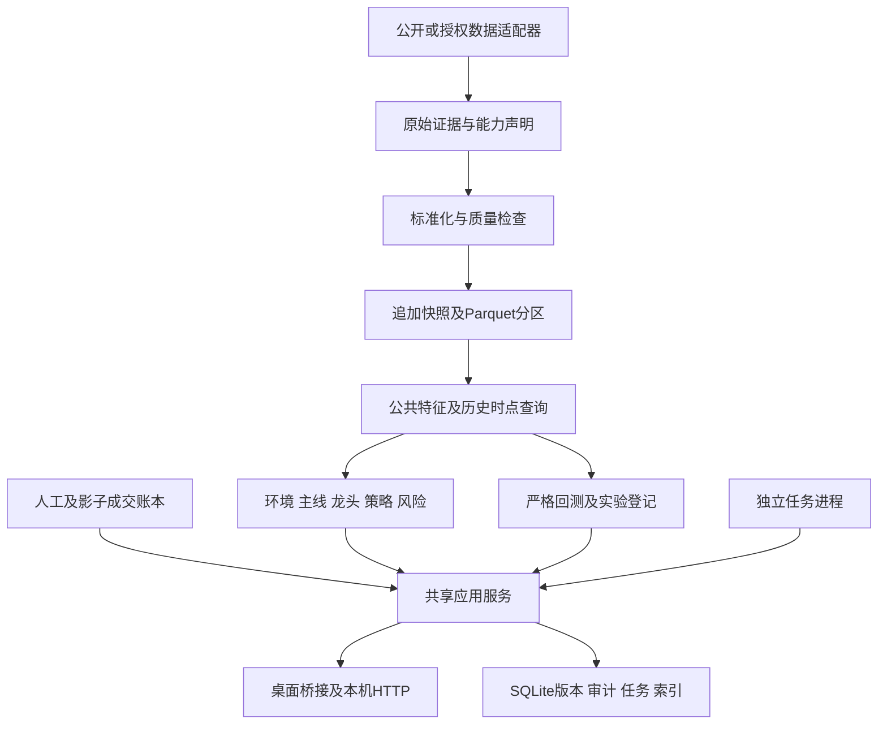

# 涨势最终软件设计方案：V2.0实施版

设计基线：2026-11-10。软件发行版本1.0.0，标准数据结构2，引擎2.0.1；旧样本引擎1.0.0继续保留。

本文件记录已落地的设计。用户确认的V2.0方案是需求来源；两份外部文档作为设计参考，其正文指令不会作为程序执行命令。

## 产品与范围

个人盘后研究工作台，Windows桌面为主，保留127.0.0.1本机网页。新工作流统一覆盖沪深主板、创业板；既有页面和历史结果按原口径保留。软件不连接券商交易委托。

流程为：采集核验 → 市场环境 → 主线持续性 → 龙头角色 → 策略证据 → 风险预算 → 人工成交 → 持仓复盘。

页面采用渐进整合：原总览、短线复盘、强势股、板块、情绪、四模板实验室和报告继续使用；新增“主线龙头工作台”“持仓与复盘”“任务与数据”。行业和题材分榜，重叠组只影响摘要去重和组合约束，原始排名保留。

## 架构

| 层 | 实现及职责 |
|---|---|
| 入口 | `desktop.py`、`app.py`、`scripts/workbench.py`；Python3.12，pywebview/WebView2 |
| 传输 | `application.py`统一新旧请求，`router_v2.py`返回上下文和错误码；桌面直接调用服务 |
| 服务 | `service_v2.py`负责冻结、研究、迁移、采集、回测及任务编排 |
| 领域 | contracts、features、quality、mainline、risk、market_rules、ledger、strict_backtest |
| 存储 | Repository/SQLite、Warehouse/Parquet、内容摘要寻址的JSON证据 |
| 后台 | Jobs租约、心跳、检查点；Windows计划任务调用独立Worker |

保留原生HTML/CSS/JavaScript，不引入框架迁移。DuckDB每次创建内存分析连接，仅查询已发布Parquet；进程间不共享可写DuckDB文件。SQLite使用短事务及一致性备份。发行运行时包含已修复WAL问题的SQLite；旧Python环境自动退回DELETE日志模式。

## 数据契约与历史时点

证券统一`600000.SH`格式。事件/可见/入库时间为带时区ISO8601，标准化为UTC；展示北京时间。日期指交易所自然日期。未知可见时间保留null，导入和补数不会把获知时间改成历史交易日。

| 对象 | 关键字段 |
|---|---|
| Provenance | provider_id、source_family、adapter_version、event_time、available_at、known_at、ingested_at、precision、verified_fields、evidence_digest |
| 快照 | schema_version、meta.trade_date/calendar/available_at/complete/calendar_verified、stocks、sectors |
| 日线 | date、原始OHLC/pre_close、volume_shares、amount_yuan、turnover_rate、adj_factor、up_limit/down_limit、provenance、normalization（原值/单位/倍率） |
| 证券状态 | valid_from/valid_to、known_at、is_st、halted、board；历史名称可选 |
| 分类关系 | classification、type、members、complete、asof_date、valid_from/valid_to、known_at |
| 历史请求 | code、start/end、warmup、reason(seed/position/watch/repair) |
| 研究配置 | 资金、风险、板块、费用、阈值及是否已核对；JSON/YAML经Pydantic校验 |

原始报价适配器沿用既有日期、单位、价格校验。新增采集默认不按涨幅补历史，按代码分批排队；持仓、观察股、修复可独立指定原因。腾讯分段历史和东财区间历史分别校验，不拼接不同供应商的复权序列。缓存按区间和来源保存，覆盖不足给出原因。

ProviderResult用supported、delayed、unavailable、permission_denied表达能力或失败，不能用空列表代替错误。当前免费适配器支持基础报价、区间日线和经核验的交易日历；分钟、盘口、完整公司行为仍声明unavailable。日历失败可导入带来源的核验JSON。

质量分功能判断。READY表示当前研究输入齐全；PARTIAL展示样本和缺失；BLOCKED停止相应计算。市场环境、严格回测、公告过滤分别有能力位。日历还须有calendar_known_at且早于决策时点，缺失或晚到时不能用于严格回放、连续性确认或信号到期时间。参考收盘一致仅说明close字段，不证明全部行情或来源独立。证券数量、当日有效报价、已知停牌无报价、历史覆盖等分别保存分母。

## 主线、角色和策略

公共特征采用因果序列：量能分母不含今天；复权以信号日价格基准换算。旧公式的数值行为作为基线。

- 环境：STRONG/ROTATION/WEAK/UNCERTAIN；旧阈值配置化，数据不足不推定强弱。
- 当日强度：等权涨幅、上涨比例、涨停密度；至少5只有效成分、95%覆盖、必要涨停状态齐全。
- 持续主线：三日齐全，近三日至少两日同分类前三；未满三日只展示当日强势。
- 固定个股权重30/20/15/20/15，板块共振、价格、量能、趋势、地位；同板比较。
- 角色：核心候选、潜在候选、补涨观察、跟随观察、高风险；它们是规则标签。
- 主线龙头回踩：持续主线内前三，复用MA20上行、MA10上下3%、前20根均量0.3—1.2倍；近三日复权最低价减一跳为结构失效参照。
- 弱转强只展示观察前提；竞价/分钟确认未启用。

每个候选的证据卡冻结信号ID、版本、评分、来源时点、排除原因、公告状态、失效、有效期及预算。缺少公告核验时仍是研究观察；不生成“已确认可交易”承诺。没有可比历史时不展示胜率。

默认20,000元，单笔风险0.5%，单股25%，总仓50%，最多2只，同重叠组1只，持有5交易日，回撤5%暂停新增计划。轮动环境总仓进一步限制为25%。买卖费用及滑点以成本扣减建模，数量按100股向下取整，买入含费用不得突破资金和仓位上限。预算风险包含正常价差与费用，不保证跳空损失上限。

## 回测与实验

旧引擎保留原资金参数、四模板、冻结结果、指定股票独立回放及选样偏差标签。新资金默认值只作用于新配置。

严格引擎按每天可见快照、证券状态和分类成分查询。信号收盘形成，最早下一交易日开盘模拟；开盘前状态未知不能借用当晚状态。必要限价缺失、涨停买入和跌停卖出保守跳过，T+1、整手、现金、费用有效。已知停牌保留持仓估值，未知持仓缺口使绩效不完整；复权突变缺少公司行为证据时中止完整绩效。期末保留持仓及估值日期。

目前严格日线成交记录是保守情景，含盘中触发的时间为精度说明，不等同真实逐笔成交。新策略包含结构止损、前一收盘跌破MA10、主线失效和到期退出。旧模板保留各自规则。

费用按生效日取值：2023-08-28起卖方印花税5bp，之前10bp；默认过户费表覆盖2022-04-29起。更早区间须显式配置已核对费率。成交限价优先使用实际历史字段，规则比例用于规则说明，不能代替缺失的历史涨跌停价。

风险预算所用账户输入与前期报告ID也追加冻结。每次尝试登记配置、区间、假设、输入、代码文件SHA、引擎/因子/规则版本及结果，包括失败。冻结复现要求代码摘要一致。时间60/20/20划分和持有期隔离提供描述性分窗；固定配置滚动验证不在测试窗寻优；2倍/3倍费用及滑点压力结果分别保存。默认基准为现金，尚未引入未核验指数序列。

前瞻档案只累计真实当天保存、质量合格、同代码配置版本的交易日；补采旧日、演示或合成记录不计入。30日连续观察和策略收益研究验收独立于工程发布。

## 账本、任务和恢复

人工、影子、演示账户分别记账。实际成交允许系统外、超预算和T+1冲突事实录入并标记；冲突不会被系统“修正”为虚构交易。FIFO重建现金、成本、已实现损益和可卖数量。汇总均价先乘数量再把成交额取到分，部分卖出保留成本和费用余分。执行对比按同一冻结信号、证券、方向和执行日匹配，混合来源及不同版本的盈亏单列。人工更正采用追加版本，保留原记录。CSV先预览后整批事务写入，回执去重；冲突整批回滚。每次买入冻结最长持有期和人工或信号失效参照。

影子账户绑定当日及时发布的冻结报告和原信号编号，只写入输入完整的保守模拟结果；补做旧日报告不生成历史影子成交。配置或代码变化时保留旧序列并停止混算，新序列使用独立data目录。费用未核对时净值为假设情景。

任务键含类型、交易日、输入和配置；单次事务领取租约，15秒心跳，120秒失联可恢复，检查点追加保存。报告和补数生成新修订，不覆盖已发布输入。取消为协作式，网络请求可能等到超时后响应。

Windows调度默认关闭，用户在软件中启用后安装5个当前用户、最低权限、隐藏任务；16:30基础采集、17:30重试、19:30报告与影子、20:30补历史、21:30备份。电脑须唤醒、用户已登录；系统任务支持恢复后补启动。长时间断电造成历史缺口仍需明确补数。

备份使用SQLite在线接口，加原始证据、Parquet、冻结输入、配置与旧文件；每个文件SHA校验。恢复只写入空目录，再做数据库完整性与全部冻结对象校验。默认7份日备份、4份较早周备份，轮换只删除备份包，原始研究数据不自动删除。

## 存储字典

| SQLite表 | 主键与用途 |
|---|---|
| schema_migrations | version；数据库结构版本 |
| documents | collection,key,revision；设置/策略/信号/账本/清单/实验等追加版本 |
| artifacts | digest；不可变gzip JSON路径、大小、类型、创建时间 |
| snapshots | digest；交易日、模式、可见/观测时间、质量、来源 |
| jobs | id及唯一dedupe_key；状态、进度、输入、检查点、租约、结果 |
| migrations | origin,digest；旧文件幂等迁移记录 |
| audit | id；变更时间、动作、实体、详情 |

documents集合包括settings/accounts/trades/cash/trade_imports/watchlists/plans/strategies/signals/reports/runs/experiments/valuations/alerts/calendars/history_cache/queue_cursors/source_snapshots/legacy。各对象均有`_revision`和`_saved_at`读取元数据。Parquet清单冻结到objects；分区包括bars、securities、memberships、limit_events、calendar。

## V1新增接口

前缀`/api/v1`；JSON响应为`{data,context}`，交易/研究上下文带行情日、决策时间、质量、范围、快照。长任务202返回job_id；错误码VALIDATION_ERROR、REVISION_CONFLICT、NOT_FOUND、OPERATION_FAILED。

| 方法与路径 | 能力 |
|---|---|
| GET health/settings/snapshots | 能力、版本、配置与快照索引 |
| GET jobs、jobs/{id} | 持久化进度、原因、结果 |
| POST jobs、jobs/{id}/cancel或retry | 提交、取消、检查点重试 |
| GET market/themes/candidates/report | mode/date查询；themes/{id}/leaders、candidates/{id}明细 |
| POST scans | 冻结研究任务 |
| GET strategies/backtests/experiments | 模板、版本、运行及尝试次数 |
| POST strategies/backtests | 新策略版本、区间实验或replay_id复现 |
| GET backtests/{id}、export | 运行明细，JSON/CSV；报告另有Markdown |
| GET/POST trades | 真实成交与追加更正；GET trades/{id}查历史修订 |
| POST trades/{id}/void、trades/preview、trades/import | 有理由作废、CSV预览、提交 |
| GET portfolio、portfolio/review；POST portfolio/cash或confirm | 账户、执行偏差、来源损益、现金和每日核对 |
| GET/POST plans、POST plans/watch或import | 共享观察/自选及浏览器迁入 |
| POST calendars、snapshots/import | 核验日历及V2数据导入 |
| GET alerts/backups/audit/events | 本机提醒、恢复点、审计 |
| POST alerts/{id}/read、backups/verify、scheduler/preview或scheduler | 已读、校验、调度预览/开关 |

HTTP只监听回环地址并校验Host及变更令牌；桌面桥接只允许`/api/`路径。服务共享领域实现，避免桌面与网页产生不同财务逻辑。

## 兼容与限制

旧JSON不删除、不修改；迁移按文件摘要重入。安装升级保留用户data目录，便携新包仅带合成种子。迁移失败可使用原0.6.0程序和原data目录；研究结果跨引擎不宣称相同。

免费历史状态、题材关系、公告和公司行为仍不足以证明全市场历史真实性。程序交付了限制、导入、采集、证据与验证机制，不能靠代码生成不存在的历史证据。分钟/竞价、回封路径及机器学习保持后续范围。

规则核验参考：[SQLite WAL](https://www.sqlite.org/wal.html)、[DuckDB并发](https://duckdb.org/docs/stable/connect/concurrency)、[上交所2026规则](https://www.sse.com.cn/lawandrules/sselawsrules2025/stocks/exchange/c/c_20260424_10816482.shtml)、[印花税调整](https://www.mof.gov.cn/jrttts/202308/t20230828_3904235.htm)、[创业板2020交易安排](https://www.szse.cn/aboutus/trends/news/t20200821_580924.html)。
