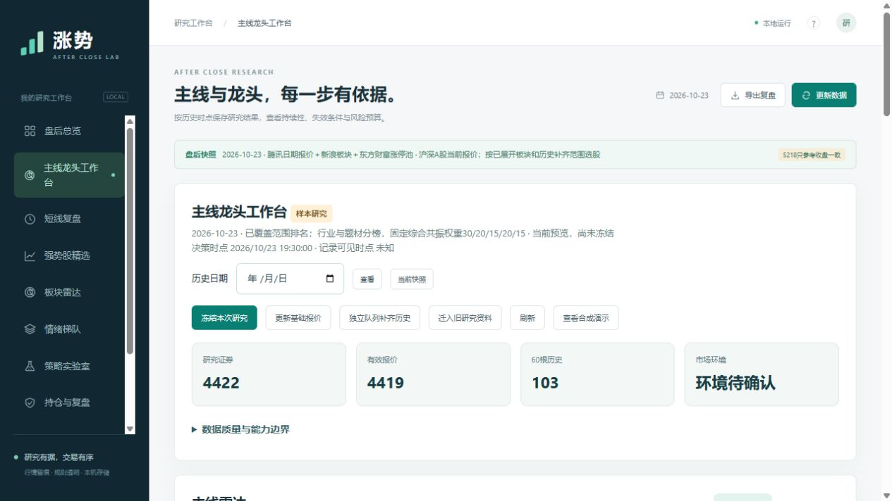

# 涨势1.0.0交付验证记录

验证完成日期：2026-11-11。发布源代码版本：`785ced81dd6eeaab82eefb9397f50eea186b0178`。代码摘要：`d0ed935861e5faba238f81332ffef586734e779097d9431a1713d8003a9ab76a`。

本次完成工程研究版实现和同机隔离验证。完整历史数据、实际部署和策略有效性的外部验收继续保留。

## 回归与兼容

- **201项Python测试全部通过**；原147项和新增54项覆盖领域、时点、存储、任务、账本、接口及修订边界。
- **9个前端脚本、66项检查全部通过**；覆盖旧模式、异步状态、表单、CSV预览、共享修订、新工作台及执行复盘。
- 实际2026-10-23快照与0.6.0基线逐项对比：三选股风格、四模板扫描和旧组合回放一致；含20笔已退出交易。
- 旧JSON共765个文件摘要保持不变；追加迁移可重跑，第二次不增加记录。
- 完整备份恢复到新的空目录，数据库完整性、冻结对象、原active摘要及候选结果核对通过；恢复禁止覆盖非空目录。

## 界面与发行程序

实际浏览器验收覆盖：新主线页面、质量降级、演示成交、CSV错误阻止与有效提交、追加更正、独立备份、刷新后任务保留和备份校验；测试仅写入build/ui-qa中的演示账户，控制台未见错误。

打包桌面实际启动，使用本机WebView2、file协议及进程内桥接；读取5223只原快照证券、11个导航入口。旧策略实验室及主线、执行复盘、持仓、任务页面加载通过。窗口退出后，独立打包Worker完成迁移、Parquet、研究、备份、校验及恢复，共6步，原快照未变。

Inno Setup已成功编译安装包，便携包仅含合成种子。**未执行正式安装/卸载，未在干净Windows设备验收安装升级。** 系统任务注册、通知和休眠恢复也须部署验收。

## 修复与关键边界

- 龙头角色、日历与完整股票池的历史可见性、信号有效期和配置冻结摘要通过回归。
- 均价先乘数量再取分，FIFO保留成本余分；执行复盘只比较同一冻结信号和执行日，异常及系统外成交保留解释。
- 补数任务记录持仓、观察及中性队列原因；成功补数自动发布新研究修订，任务去重区分历史版本，旧报告保持不变。
- 影子账户使用当日及时发布的原报告信号；晚补旧日报告不生成历史成交。代码、配置或数据修订改变既有成交时停止，保护原账本，较早请求不能倒退账户。
- 未来数据不改过去；晚到状态不能驱动早盘；T+1、整手、现金与费用、保守涨跌停、停牌/未知缺口和公司行为异常分别处理。
- CSV冲突整批回滚；任务单一租约、检查点、失联恢复和去重；日备份与更早不同周的保留均有测试。

报告冻结证券输入、配置、代码、因子、交易规则及风险预算账户输入，并保留前期主线报告ID。

## 真实接口与数据边界

东方财富公开区间接口的隔离采样通过：600000.SH，申请2026-10-16至2026-10-23及预热，共22根日线。保留原始证据摘要、单位换算、完整区间Parquet及缓存；历史可用时间仍为null。

该结果仅证明一次请求成功。原快照仍为PARTIAL：主板/创业板4422只、4419只有效报价、103只有60根历史。历史股票池、状态、题材、公告及公司行为证据不足时，严格回测返回BLOCKED。真实接口成功不能证明策略有效。

## 性能实测

Windows-11-10.0.26200-SP0，Python3.12.14，8个逻辑CPU。已落地当前快照的日级计算约**2.081秒**；不包含网络、首次补齐或多年全市场数据。

| 只读接口 | 中位数 | 8次样本最大值，作为保守P95近似 |
|---|---:|---:|
| health | 28.82ms | 30.12ms |
| jobs | 3.52ms | 4.22ms |
| report | 10.04ms | 11.19ms |
| portfolio | 43.23ms | 46.85ms |
| plans | 7.84ms | 8.62ms |
| experiments | 11.61ms | 12.72ms |

以上是本机小样本，未替代4核、16GB、SSD参考设备及负载验收。

## 尚需实际完成

1. 完整历史状态、分类/题材、公告及公司行为的数据来源与时点验收。
2. 最终规则冻结后真实积累30个连续交易日；样本外、基准、成本及不同环境的策略验证。
3. 干净Windows安装升级、实际计划任务和通知、断网/休眠恢复及参考硬件性能验收。

后台调度默认关闭；本轮未注册系统任务，也未发出交易委托。分钟、竞价和盘口确认属于后续扩展。

机器证据：[回归](validation-v2-regression.json)、[兼容/迁移/恢复/性能](validation-v2.json)、[桌面和Worker](validation-v2-desktop.json)、[区间接口](validation-v2-provider.json)、[发行摘要](validation-v2-release.json)。详见[完成情况复核](completion-audit.md)。构建和详细日志保留本机build目录。
